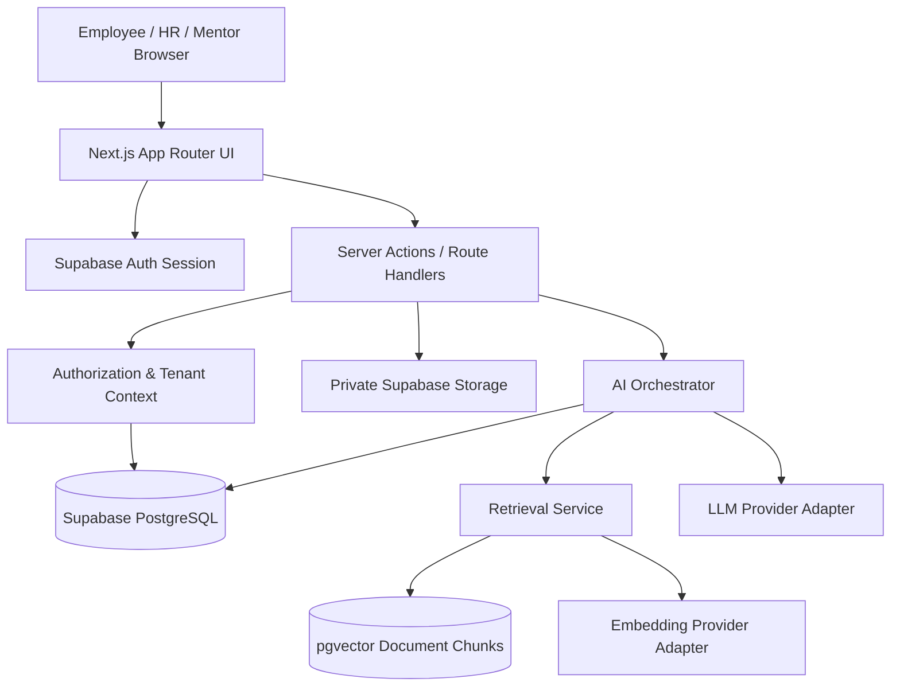

# System Architecture — OnboardMate

## 1. Architecture decisions
- Use a modular monolith for the MVP: one Next.js App Router application with clear service boundaries.
- Use TypeScript strict mode.
- Use Supabase for Auth, PostgreSQL, private Storage, and pgvector.
- Keep LLM and embedding providers behind interfaces/adapters.
- Use server-side routes/services for privileged operations and AI orchestration.
- Do not expose Supabase service-role credentials or AI provider keys to the browser.
- Design tenant isolation from the start using organization membership and RLS.

## 2. Logical architecture



## 3. Main application modules
- `auth`: session management, invitations, role/membership resolution.
- `organizations`: organization profile and membership.
- `employees`: employee profile and department membership.
- `onboarding`: templates, assignments, tasks, progress.
- `knowledge`: document metadata, upload, extraction, chunking, indexing, publication.
- `ai`: provider interfaces, orchestration, tool registry, conversation handling.
- `rag`: query embedding, tenant-scoped retrieval, context assembly, citations.
- `audit`: audit events for sensitive administrative actions.
- `reports`: basic organization-level onboarding summaries.

## 4. Proposed source structure

```text
src/
  app/
    (public)/
      page.tsx
      login/
      invite/
      auth/callback/
    (employee)/
      app/dashboard/
      app/assistant/
      app/checklist/
      app/knowledge/
      app/profile/
    (hr)/
      hr/dashboard/
      hr/employees/
      hr/invitations/
      hr/onboarding/
      hr/documents/
      hr/reports/
    api/
      ai/chat/route.ts
      hr/invitations/route.ts
      hr/documents/route.ts
      hr/documents/[id]/process/route.ts
  components/
    ui/
    layout/
    employee/
    hr/
    assistant/
  features/
    auth/
    onboarding/
    employees/
    documents/
    assistant/
  lib/
    supabase/
    env/
    validation/
    permissions/
  services/
    ai/
    rag/
    documents/
    onboarding/
    invitations/
  types/
supabase/
  migrations/
  seed/
docs/
plans/
```

The exact folder layout can be refined by the implementation plan, but UI, business logic, data access, and provider adapters must remain separated.

## 5. Key data flows

### Invitation flow
1. HR Admin submits invite request.
2. Server validates session, organization membership, and invite permission.
3. Server creates a pending invitation record.
4. Server invokes the auth provider's invitation mechanism using a server-only credential.
5. Recipient follows the secure invitation link.
6. Auth callback validates the invitation and activates organization membership.
7. Audit event is recorded.

### Onboarding assignment flow
1. HR creates a template and tasks.
2. HR assigns a template to an employee.
3. Application creates assignment and task progress records.
4. Employee views assigned tasks.
5. Employee updates eligible task status.
6. Server validates ownership and permitted transition.
7. Progress is recalculated from task records.

### Document ingestion flow
1. HR uploads a permitted PDF/DOCX to private storage.
2. Server validates role, organization, file type, and size.
3. Document metadata is recorded as `uploaded`.
4. Processing extracts text; scanned-image-only documents are marked unsupported unless OCR is added later.
5. Text is normalized and split into chunks with overlap.
6. Embedding adapter generates vectors.
7. Chunks and metadata are stored; document becomes `indexed`.
8. HR reviews and publishes document to a permitted audience.
9. Failed processing records a safe error code and can be retried.

### AI query flow
1. Authenticated employee sends a question.
2. Server derives organization and user identity from the verified session; never trust client-supplied organization/user IDs.
3. Server resolves the organization's display name from the verified `organizations` record and injects it into the system prompt at runtime — the system prompt template must never contain a hardcoded organization name.
4. Authorization filter determines documents accessible to that user based on `audience` and, for `selected_roles` documents, a join against `document_access_roles`.
5. Query embedding is generated through the configured embedding adapter.
6. Vector search retrieves only published, authorized, same-organization chunks. The retrieval service must apply `organization_id`, `is_published`, `audience`, and role filters server-side — these filters must not be passed from or bypassed by the client. The Supabase service-role client, if used for vector retrieval, does not benefit from RLS and must apply all authorization logic explicitly in the query.
7. Context assembly includes content and citation metadata; each citation must include `document_id`, `chunk_id`, `document_version`, and available section/page metadata.
8. LLM adapter generates an answer under the system prompt and grounding rules.
9. Server validates citations against retrieved chunk IDs before returning or storing them.
10. Response and citation metadata are stored and returned.

## 6. Provider-agnostic AI design
Define stable application interfaces such as:
- `LLMProvider.generateResponse(input)`
- `EmbeddingProvider.embedTexts(texts)`
- `EmbeddingProvider.embedQuery(query)`

Provider-specific SDKs must be isolated in adapter modules. Business logic must not import a vendor SDK directly.

Provider-agnostic does not mean every model is interchangeable without migration. Embedding dimensions and model semantics may differ. The selected embedding model and dimension must be recorded in configuration/metadata. Changing embedding models requires re-embedding all chunks; if vector dimensions change, update the database vector column/index through a migration or use a compatible storage strategy.

## 7. Background processing
For MVP, document processing may use a controlled server-side processing path with clear size/time limits and a retryable status. If deployment runtime limits make this unreliable, introduce a background worker/queue in a later phase. Do not silently run long jobs inside a request that may time out.

## 8. Deployment topology
- Next.js application: managed hosting compatible with Next.js.
- Supabase: managed PostgreSQL, Auth, Storage, pgvector.
- AI provider: configured externally through server-side environment variables.
- Git repository: source control and deployment integration.

## 9. Architecture quality gates
- No service-role key in client bundles.
- No cross-tenant retrieval.
- No direct browser-to-LLM secret calls.
- No provider SDK imports outside adapters.
- All sensitive server operations validate authorization.
- All document citations resolve to a source the user is allowed to view.
- System prompt organization name is always resolved dynamically from the verified session — never hardcoded.
- Vector retrieval authorization is applied server-side regardless of whether RLS is active for the executing database role.
